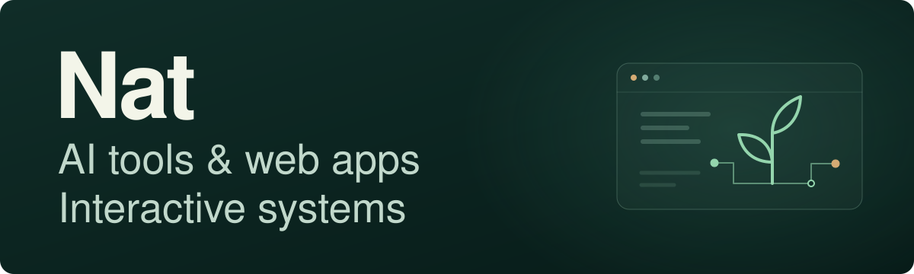

# Hi, I'm Nat 👋

I build generative AI applications, focusing on LLM evaluation, evidence-linked research, and multimodal generation.

I'm a computer science student at SUTD and part of the [Sprout](https://github.com/Neonat/sprout-web) team. I contribute to AI Pass in AI product & operations at Singtel and lead GDG on Campus at SUTD. I enjoy bringing developers together through technical workshops.

[Connect on LinkedIn](https://www.linkedin.com/in/nathaniel-sim/) · [Hugging Face](https://huggingface.co/natsim)

## Selected projects

### Sprout

A collaborative plant-to-creature game with species identification, generated sprites, creature collection, and turn-based battles.

[Code](https://github.com/Neonat/sprout-web) · [Interface mockups](https://github.com/Neonat/sprout-web/tree/main/obsidian-vault/03%20Design/Frontend%20Mockups) · [Generation examples](https://github.com/Neonat/sprout-web/tree/main/client/public/plants)

### Mira

A collaborative agentic research prototype for bank internal auditors, with source-linked findings, claim verification, and human review.

[Code](https://github.com/Neonat/mira-smu-ytp-aif-2026) · [Demo report](https://neonat.github.io/mira-smu-ytp-aif-2026/report.html) · [Dataset](https://huggingface.co/datasets/natsim/mira-hong-kong-aml-cft)

### PettiChat

During my PettiChat research internship, I worked on dialogue generation and evaluation with the team. The experiments used synthetic data, RoBERTa fine-tuning, and emotion and style checks.

[Case study](docs/case-studies/pettichat-dialogue-evaluation.md) · [Model](https://huggingface.co/natsim/cat-dialogue-RoBERTa-2) · [Dataset](https://huggingface.co/datasets/natsim/if-cats-could-speak) · [Training Colab](https://colab.research.google.com/drive/1yk_0VGDDFQGPmq1ilUdo6iXavwiKDurQ?usp=sharing) · [Synthetic data Colab](https://colab.research.google.com/drive/1mErqPP8jMdS3AdJ0TcKS34eA5mbiC7FR?usp=sharing)

  
   
  Profile companions inspired by Sprout, our collaborative plant-to-creature game.

## Models and datasets

Published research artifacts on [Hugging Face](https://huggingface.co/natsim), covering dialogue evaluation, model fine-tuning, and source-linked research.

| Artifact | Type | Focus |
| --- | --- | --- |
| [Pet-dialogue RoBERTa](https://huggingface.co/natsim/cat-dialogue-RoBERTa-2) | Model | Classifies generated pet dialogue into six emotion categories. |
| [If cats could speak](https://huggingface.co/datasets/natsim/if-cats-could-speak) | Dataset | 27,889 synthetic texts labelled for emotion-classification experiments. |
| [Mira Hong Kong AML/CFT sample](https://huggingface.co/datasets/natsim/mira-hong-kong-aml-cft) | Dataset | 18 paraphrased findings with publisher links from the collaborative Mira demo. |

Earlier models and dataset archive

- [Earlier pet-dialogue RoBERTa checkpoint](https://huggingface.co/natsim/cat-dialogue-RoBERTa).
- [Gemma pet-dialogue experiment](https://huggingface.co/natsim/petaiv2-gemma-adapters).
- [Gemma emoji experiment](https://huggingface.co/natsim/myemoji-gemma-adapters).
- [Pet-human dialogue archive](https://huggingface.co/datasets/natsim/pet_human_dialogue), an earlier dataset repository with no published data files.

## Technologies across these projects

**Languages**

**AI & ML**

**Web & data**

**Tools & hardware**

## More to explore

- **[Tandem](https://github.com/Neonat/tandem)** — a collaborative Build for Good prototype for family care updates, task ownership and caregiver handovers.
- **[Social-service text pipeline](https://github.com/Neonat/social-service-text-pipeline)** — a Dell InnovateDash 2026 prototype for PII handling, sentiment, escalation signals and category classification.
- **[Interactive stage tech](https://github.com/Neonat/sutd-02164ht-stage-tech)** — ESP32 button-driven brain visuals and a music-controlled show clock for a SUTD theatre performance.
- **[Sprout Android](https://github.com/Neonat/sprout-android)** — the Java/Android plant-to-creature game, previously called Plantemon.
- **[Scam-message checker](https://github.com/Neonat/scam-message-checker)** — a Code EXP 2026 browser prototype using explicit rules to highlight suspicious-message signals.
- **[Arcade prototype](https://github.com/Neonat/sutd-50002-fpga-arcade-machine)** — a two-player browser game and sprite studies for an arcade-machine project.

Each repository explains its implemented scope, setup, team or upstream credits, and prototype limitations.
